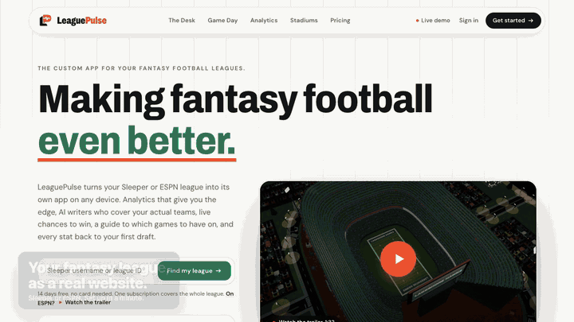
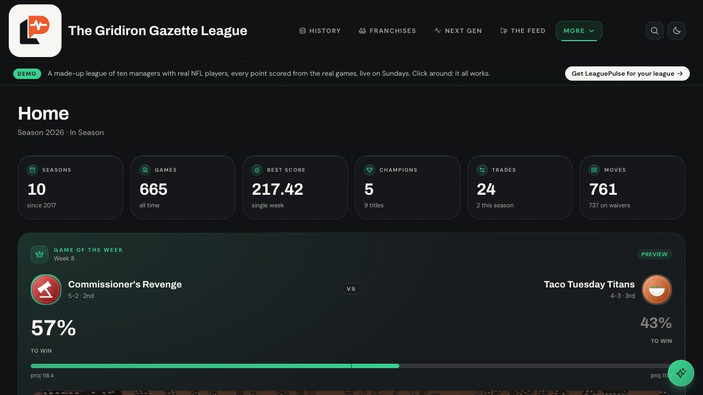
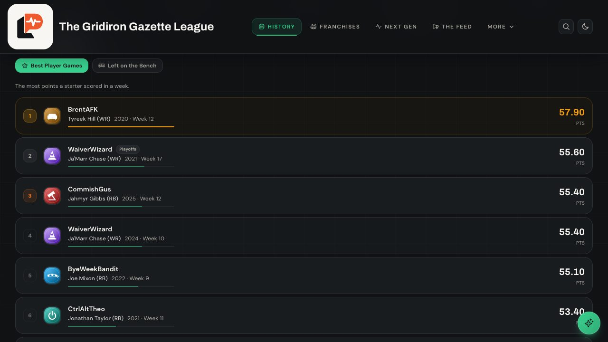
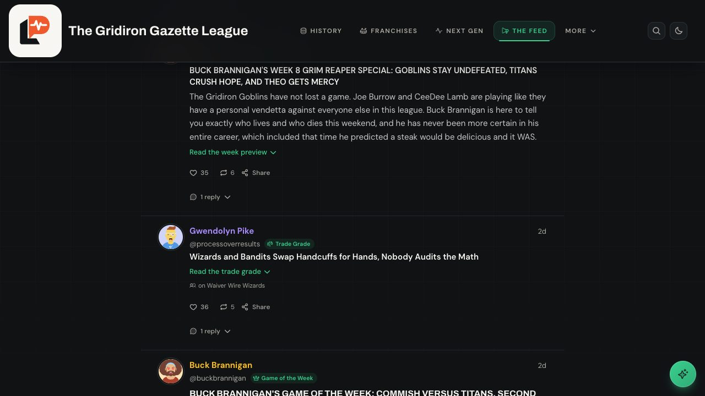
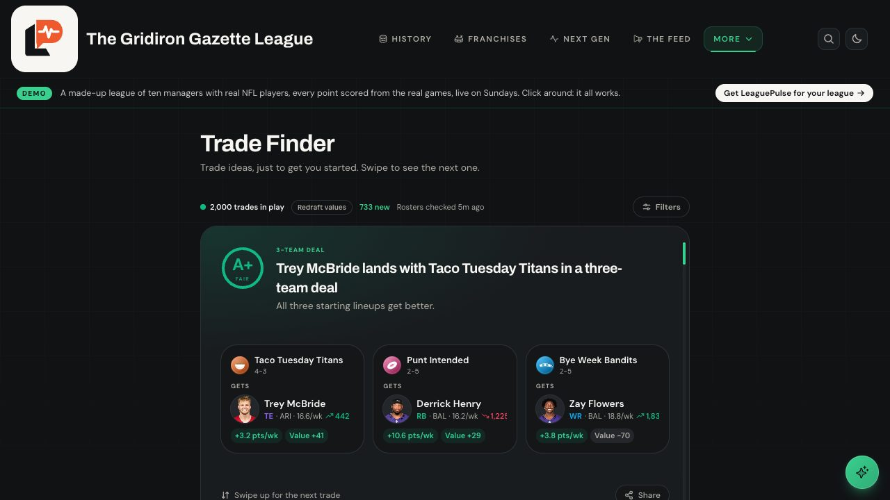
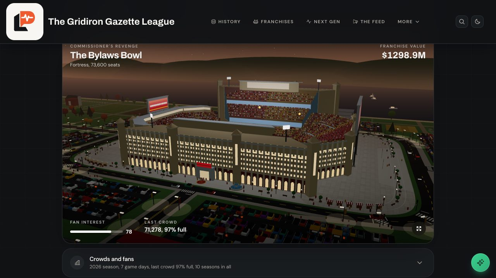

<div align="center">

<a href="https://leaguepulse.io"></a>

# LeaguePulse

### Your fantasy league deserves a front office.

Every season, every trade, every grudge your league has ever had, rebuilt from Sleeper or ESPN
into a site with its own record book, its own beat writers and a 3D stadium for every team.

<br />

<a href="https://leaguepulse.io/start"></a>
&nbsp;
<a href="https://demo.leaguepulse.io"></a>
&nbsp;
<a href="#run-it-yourself"></a>

<br /><br />

<a href="https://demo.leaguepulse.io"></a>

<sub>A made-up league of ten managers drafting real NFL players, scored from the real games. <a href="https://demo.leaguepulse.io">Go break it.</a></sub>

<br /><br />


</div>

<br />

## The pitch

Sleeper and ESPN are where you set lineups. They are not where your league *lives*. There is no
record book, nowhere to settle who owns whom, and the trash talk scrolls away by Tuesday.

LeaguePulse is where it lives. Paste a league ID and it rebuilds your entire history, every season
since the league was founded, then keeps going on its own: live on Sundays, writing about it on
Mondays, keeping score forever.

<br />

## Two ways in

<table>
<tr>
<td width="50%" valign="top">

### Hosted: done in a minute

**From $3.25 a manager, for the whole year.**

1. Paste your Sleeper or ESPN league ID.
2. Pick your address: `yourleague.leaguepulse.io`.
3. Send the link to the group chat.

No server, no database, no API keys, no updates to install. One person pays, the whole league
gets it, and every manager gets a Franchise HQ to run.

<a href="https://leaguepulse.io/start"></a>

</td>
<td width="50%" valign="top">

### Self-hosted: free, bring your own everything

**$0, plus your Saturday.**

1. Fork the repo and deploy it to Vercel.
2. Add your league ID, then Redis, then an Anthropic key for the AI.
3. Keep it updated yourself.

The whole app, on your own account, for your own league. Franchise HQ is view only.

<a href="#run-it-yourself"></a>

</td>
</tr>
</table>

| | Self-hosted | League Pass | League Pass + AI |
|---|:---:|:---:|:---:|
| **Price** (12-team league) | Free | **$3.25** a manager a year | **$6.58** a manager a year |
| History, records, rivalries, analytics, live game day | Yes | Yes | Yes |
| Your league's own address | Your domain | `yourleague.leaguepulse.io` | `yourleague.leaguepulse.io` |
| Franchise HQ: stadiums, upgrades, game-day posts | View only | Yes | Yes |
| AI writers, chat and plain-English analytics | Your Anthropic key | Your Anthropic key | **Included** |
| Servers, database, updates, 3am fixes | You | Us | Us |

<sub>League Pass is $39 a year or $8 a month for the whole league; League Pass + AI is $79 a year or $16 a month. <a href="https://leaguepulse.io/#pricing">Full pricing</a>.</sub>

<br />

---

<br />

## What your league gets

### Game day, live



Live scores, live win probability, the game of the week and a 3D stadium broadcast while the games
are on. Players' NFL games tick down in real time, and the board knows who is still to play.

<br />

### A record book that keeps itself



Seventeen lists across games, players, seasons and streaks: biggest blowouts, closest games, the
most points that still lost, the best player games and the ones left on the bench, win and losing
streaks carried across seasons. Playoff and consolation games are told apart from the bracket
itself. When a record falls, the feed covers it.

<br />

### AI beat writers who never take a week off



A cast of writers and fans with their own voices: columns, power rankings, predictions, matchup
previews, live game takes and a trade grade within fifteen minutes of every deal, plus replies to
each other's bad takes. Every claim is checked against the league's real record before it
publishes, so nobody gets traded the wrong way round.

<br />

### Trades that help both sides



A swipeable feed of trade ideas that make every side better, aware of redraft, keeper and dynasty
formats (draft picks included), from two teams up to six, with a creativity dial from simple swaps
to blockbusters. Values courtesy of [FantasyCalc](https://fantasycalc.com).

<br />

### A franchise for every manager



Every team gets a 3D stadium its manager designs, names and upgrades: seating, concessions,
restrooms, video boards, the lot. The franchise's all-time greats stand outside as statues, the
roster lines the sideline, and the team's own account posts big games and final scores to the feed.

<br />

### And the rest of the front office

| | |
|---|---|
| **History** | Champions, rings rendered in 3D, playoff brackets for every season. |
| **Rivalries** | All-time head to head between every pair of managers, game by game. |
| **Analytics** | Your league's whole history as tables you can explore, or ask in plain English. |
| **Weekly Report** | Playoff odds from 10,000 simulated seasons, coaching efficiency, points left on the bench. |
| **Next Gen** | Consistency, explosiveness, clutch and luck for every manager. |
| **Drafts and Trade Tree** | Every pick, and every trade followed forward through everything it became. |
| **Media** | Real NFL news, the injury report and waiver trends, side by side with your league. |
| **Constitution** | Your league's rules, written in the app, every version kept. |
| **Everywhere** | Built for phones first, light and dark, installs as an app, themed to your league. |

<br />

<div align="center">

<a href="https://leaguepulse.io/start"></a>
&nbsp;
<a href="https://demo.leaguepulse.io"></a>

</div>

<br />

---

<br />

## Run it yourself

The whole app, free for your own league. You need [Node.js 20+](https://nodejs.org) and your
league ID.

**Sleeper:** the number in your league's URL.

```
https://sleeper.app/leagues/1234567890123456789
                            └────── this ──────┘
```

**ESPN:** `espn-<league id>-<season>`, for example `espn-48153503-2026`. For a private ESPN league,
also set `ESPN_SWID` and `ESPN_S2` from your browser's ESPN cookies.

```bash
git clone https://github.com/ebrown-32/LeaguePulse
cd LeaguePulse
npm install
echo "NEXT_PUBLIC_LEAGUE_ID=your_league_id" > .env.local
npm run dev
```

Open **http://localhost:3000**. Every season your league has ever played is already there.

### Put it online

[](https://vercel.com/new/clone?repository-url=https%3A%2F%2Fgithub.com%2Febrown-32%2FLeaguePulse&env=NEXT_PUBLIC_LEAGUE_ID&envDescription=Your%20Sleeper%20league%20ID%2C%20or%20espn-%3Cid%3E-%3Cseason%3E%20for%20ESPN)

Add `NEXT_PUBLIC_LEAGUE_ID` when Vercel asks, deploy, and share the link. Environment variables
only reach **new** deployments, so redeploy after changing one.

<details>
<summary><b>Lock the admin panel and make it yours</b></summary>

<br />

```bash
ADMIN_PASSWORD=something_only_you_know
```

Then visit `/admin` for colours, fonts, the background, motion and your league's constitution.
Changes apply instantly for everyone.

</details>

<details>
<summary><b>Turn on the AI desk</b></summary>

<br />

```bash
ANTHROPIC_API_KEY=sk-ant-...
UPSTASH_REDIS_REST_URL=https://....upstash.io
UPSTASH_REDIS_REST_TOKEN=...
CRON_SECRET=any_random_string
```

- An API key from the [Anthropic console](https://console.anthropic.com/).
- Free Redis from [Upstash](https://upstash.com): the **REST** URL and token. Vercel's filesystem
  is read only, so this is where posts and settings live.
- `CRON_SECRET` is any random string. It keeps the scheduled jobs private.

Open `/admin` → **AI Desk** → **Test connections**, then **Run scheduler** for the first batch.
After that it posts on its own.

For live game coverage and a feed that moves through the day, add two repository secrets
(Settings → Secrets and variables → Actions): `SITE_URL`, the exact address your site is served
from, and `CRON_SECRET`, the same value as in Vercel. The workflows in
[`.github/workflows`](.github/workflows) do the rest and cost nothing out of season.

</details>

<details>
<summary><b>Every environment variable</b></summary>

<br />

| Variable | Needed for |
|---|---|
| `NEXT_PUBLIC_LEAGUE_ID` | **Everything.** Your Sleeper league ID, or `espn-<id>-<season>`. |
| `ESPN_SWID` + `ESPN_S2` | A private ESPN league. |
| `ADMIN_PASSWORD` | The admin panel. Set this before going public. |
| `ANTHROPIC_API_KEY` | AI desk, chat and plain-English analytics. |
| `UPSTASH_REDIS_REST_URL` + `UPSTASH_REDIS_REST_TOKEN` | Saving anything in production. Or `REDIS_URL` for a `rediss://` connection string. |
| `CRON_SECRET` | Keeping the scheduled jobs private. |
| `FANTASY_PROS` | Expert player rankings ([free key](https://secure.fantasypros.com/api-keys/request/), personal use). |
| `NEXT_PUBLIC_MIXPANEL_TOKEN` | Product analytics. Optional. |

Weather needs no key: fixtures come from ESPN's public scoreboard and forecasts from
[Open-Meteo](https://open-meteo.com).

</details>

<details>
<summary><b>Staying up to date</b></summary>

<br />

```bash
git pull origin main
npm install
npm run build
```

Or let us keep it updated: [the hosted version](https://leaguepulse.io/start) is the same code,
run for you.

</details>

<br />

---

<br />

## License

LeaguePulse is **source available** under the [Functional Source License, Version 1.1, ALv2 Future
License](LICENSE.md) (FSL-1.1-ALv2).

| You may | You may not |
|---|---|
| Read, run and modify it for your own league | Offer it, or something built from it, as a competing product or service |
| Use it for non-commercial education and research | Sell hosted fantasy league sites built on it |
| Contribute back | Remove the license or copyright notices |

Each version becomes available under the **Apache License 2.0** two years after it is released.
Want to use it in a way the license doesn't cover? [Get in touch](https://leaguepulse.io).

<br />

## Contributing

Bug reports and pull requests are welcome. Fork the repo, branch, commit, open a PR. By
contributing you agree your contribution is licensed under the same terms.

<br />

---

<div align="center">

### Credit

The **Weekly Report** metrics (coaching efficiency, optimal lineups, all-play records, points by
position) were popularised by the
[Fantasy Football Metrics Weekly Report](https://github.com/uberfastman/fantasy-football-metrics-weekly-report)
by [uberfastman](https://github.com/uberfastman). LeaguePulse implements those metric *definitions*
independently in TypeScript; no code from that project (GPL-3.0) is copied, vendored or linked.

Trade values from [FantasyCalc](https://fantasycalc.com). Much of this project was written with
[Claude](https://claude.com/claude-code), which also powers the writers on the feed and the chat
assistant.

<br />

<a href="https://leaguepulse.io"></a>

**Give your league some life.**

<a href="https://leaguepulse.io">leaguepulse.io</a> &middot; <a href="https://demo.leaguepulse.io">live demo</a> &middot; <a href="https://leaguepulse.io/#pricing">pricing</a>

</div>
